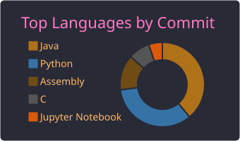

  

  ## Arthur Santos
  `arthuneas`

  Estudante de Ciência da Computação na UnB — Pesquisador em Formação

  
  

---

Sou estudante de Ciência da Computação (querendo dupla com Engenharia de Computação) na Universidade de Brasília, com interesse em desenvolvimento de software, inteligência artificial, embarcados e análise de dados. Busco unir prática profissional e pesquisa científica para entender como a tecnologia transforma a sociedade.

Minhas atuações incluem engenharia de requisitos; desenvolvimento, teste e homologação de software; análise de algoritmos de IA, redes neurais e machine learning; consulta, análise e desenvolvimento de bancos de dados; elaboração de relatórios técnicos e versionamento de código; aplicação de IA em sistemas embarcados e integração entre hardware e software.

---

### Pesquisa e Extensão

- **Ensino de Programação Básica** — projeto de extensão para introduzir lógica computacional no combate da desinformação em escolas públicas do DF.
- **IA Embarcada e IHC aplicados ao ensino** — investigação sobre interação humano-computador no contexto do ensino de inteligência artificial e a integração da IA com a robótica.
- **Redes Neurais para Processamento de Sinais** — projeto de iniciação cientifica do Observatório Sismológico com a empresa Braskem para classificação de sinais sísmicos com técnicas de aprendizado profundo.
- **IEEE CSS** — membro do capítulo estudantil de controle: atuando na construção de um sistema ciberfísico e membro do grupo de estudos de IA.
- **Ramo Estudantil IEEE UnB** — vice diretor de projetos na gestão do ramo estudantil.

---

### Linguagens e Ferramentas

  
  
  
  
  
   
  
  
  
  

---

  

  

